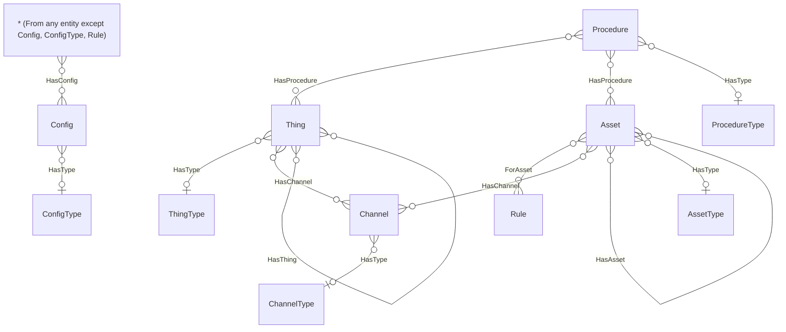

# iotdatamodel

Generic data model for Internet of Things



## Usage

```bash
npm install iotdatamodel
```

```js
import {
  associationSchemas,
  connections,
  datamodelVersion,
  entitySchemas,
  schemas,
} from 'iotdatamodel';
```

| Export               | Content                                                    |
| -------------------- | ---------------------------------------------------------- |
| `entitySchemas`      | JSON Schemas of the entities (Asset, Thing, Channel, …)    |
| `associationSchemas` | JSON Schemas of the associations (HasChannel, HasType, …)  |
| `schemas`            | `entitySchemas` followed by `associationSchemas`           |
| `connections`        | Every allowed connection, see [Connections](#connections)  |
| `datamodelVersion`   | `major.minor` of the package version, e.g. `'9.1'`         |

Each schema is identified by its `title`. A single schema can also be imported as JSON:

```js
import assetSchema from 'iotdatamodel/entities/Asset.json' with { type: 'json' };
import hasTypeSchema from 'iotdatamodel/associations/HasType.json' with { type: 'json' };
```

The package is an unbundled ES module that imports its schemas with JSON import attributes. It
needs Node 22 or later, or a bundler that supports import attributes. CommonJS can
`require('iotdatamodel')` on Node 22.12 or later.

## Schema conventions

The schemas declare no `$schema` and use only keywords common to JSON Schema draft-07 and later,
plus four custom keywords:

| Keyword | Where    | Meaning                                                                    |
| ------- | -------- | -------------------------------------------------------------------------- |
| `link`  | property | `title` of the entity schema the property refers to                        |
| `via`   | property | `title` of the association schema that carries the `link`                  |
| `index` | property | index kind of the property: `unique` or `notunique`                        |
| `meta`  | schema   | storage metadata; `meta.orientdb.super`: `V` entity, `E` association       |

Associations may also carry the edge uniqueness flags `meta.orientdb.uniqueEdge` and
`meta.orientdb.uniqueIdEdge`.

A validator in strict mode rejects unknown keywords, so the custom ones must be registered. With
[Ajv](https://ajv.js.org):

```js
import Ajv from 'ajv';
import { schemas } from 'iotdatamodel';

const ajv = new Ajv({ allowUnionTypes: true, keywords: ['meta', 'link', 'via', 'index'] });
const validators = Object.fromEntries(
  schemas.map((schema) => [schema.title, ajv.compile(schema)]),
);

validators.Asset({ rid: '#12:0', id: 'pump-1' }); // true
```

## Connections

A property with `link` and `via` declares one allowed connection: from the entity that has the
property, through the `via` association, to the `link` entity.

```json
"type": {
  "type": ["string", "null"],
  "link": "ConfigType",
  "via": "HasType"
}
```

`connections` lists them all, in schema and property order:

```js
import { connections } from 'iotdatamodel';

// [{ association: 'HasType', from: 'Asset', to: 'AssetType', property: 'type' }, …]

const isAllowed = ({ association, from, to }) =>
  connections.some(
    (connection) =>
      connection.association === association && connection.from === from && connection.to === to,
  );

isAllowed({ association: 'HasType', from: 'Config', to: 'ConfigType' }); // true
isAllowed({ association: 'HasType', from: 'Thing', to: 'ConfigType' }); // false
```

A connection that is not listed is not allowed. JSON Schema validates one document at a time, so
the schemas only declare the connections; whatever creates an association enforces them.

## Versioning

The package follows [Semantic Versioning](https://semver.org); changes are listed in
[CHANGELOG.md](CHANGELOG.md). `datamodelVersion` is written by `npm version` and always equals the
`major.minor` of the package version.

## Development

```bash
npm test
```

There is no build step: `src/` is published as is.
